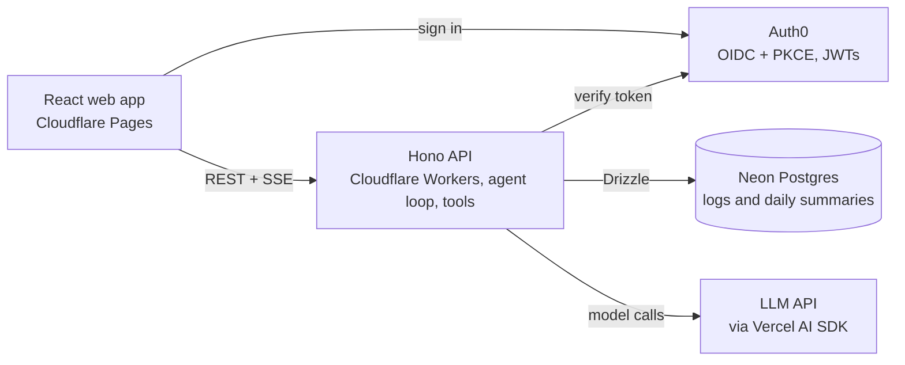

# AI Wellness Coach: Project Plan

Living design doc for this project. Last updated October 2026.

## Overview and goals

A personal wellness journal and coach: describe what you ate, how you moved, and how you slept in plain English, and above all how you felt. An AI agent turns each sentence into structured data and helps you notice what leaves you feeling good.

Example inputs:

- "I went for a 3-hour mountain bike ride with a friend and felt great."
- "Did a CrossFit class tonight and felt sluggish."
- "For breakfast this morning, I had three eggs and a half cup of oats."
- "Slept about six and a half hours, woke up groggy but in a good mood."

Goals:

1. **Learn new skills:** full-stack TypeScript, AI agent design with tool calling, LLM evals, and low-cost cloud hosting outside AWS.
2. **Portfolio piece:** a live, deployed app with a clean repo and design doc to walk through in interviews.
3. **Daily personal use:** understand which habits around food, movement, and rest leave me feeling energetic and ready for fun things at a recreational level.

Design principle: how you feel is the outcome that matters. Performance numbers are optional context, never the goal, so there are no PRs, streaks, or targets to chase.

Non-goals: third-party API imports (Concept2, Strava, wearables), performance training analytics (PRs, power, pace targets), and medical or diet prescriptions.

## Tech stack and hosting

Full-stack TypeScript in one pnpm monorepo, expected to cost roughly $0 to $10 per month including LLM usage.

| Layer      | Choice                      | Hosting                         | Notes                                                                                    |
| ---------- | --------------------------- | ------------------------------- | ---------------------------------------------------------------------------------------- |
| Frontend   | React + TypeScript, Vite    | Cloudflare Pages                | Static SPA, free tier                                                                    |
| Backend    | Hono on Cloudflare Workers  | Cloudflare Workers + Hyperdrive | Node entry for local dev and tests                                                       |
| Database   | Postgres + Drizzle ORM      | Neon                            | Scale-to-zero free tier; pgvector available later                                        |
| Auth       | Auth0 (Free plan)           | Hosted by Auth0                 | SPA signs in with OIDC + PKCE; API validates JWT access tokens against the JWKS endpoint |
| AI         | Vercel AI SDK + an LLM API  | Provider-hosted                 | Small, fast model tier for parsing                                                       |
| Validation | Zod                         | Shared package                  | One schema per tool, used everywhere                                                     |
| Testing    | Vitest + parsing eval suite | GitHub Actions                  | Evals run on every PR                                                                    |

Repo layout:

- `apps/web`: React app, chat UI, confirmation cards, dashboards
- `apps/api`: Hono API, agent loop, tool handlers, stats queries
- `packages/shared`: Zod schemas, types, unit conversions, totals and rollup logic

The shared package is the backbone: each tool schema drives the model's tool definition, API validation, and the React confirmation card, so the three can never drift apart.

Hosting and deployment (issue #5):

- **API on Cloudflare Workers** (chosen over Fly.io): no cold starts after idle (Fly auto-stop meant 2 to 5 seconds), one platform for web and API, and no containers to maintain. The cost is a different production runtime (workerd) from local dev and tests, so CI bundles the Worker on every build to catch code that cannot run there. Fly.io remains a good fit if long-lived connections or background processes are ever needed.
- **Database access through Hyperdrive**, Cloudflare's connection pooler in front of Neon. `worker.ts` opens a postgres.js client per request on the Hyperdrive connection string; the production database URL lives in Hyperdrive and in a GitHub `production` environment (limited to `main`) for migrations.
- **Limits to watch**: the Workers free plan allows 100,000 requests per day and 10 ms of CPU per request (waiting on the database or an LLM does not count). The Phase 2 agent loop may need the $5/month plan; Hyperdrive's free plan allows 100,000 queries per day.
- **Release order on merge to `main`**: CI, then database migrations, then the Worker, then the web app on Cloudflare Pages, so a new web app never calls an older API. A failed migration stops the release and leaves the live API untouched. In the other direction, migrations run before the new Worker is live, so each one must be backward compatible with the previous Worker (add columns and tables first, then remove or rename in a later release once nothing uses them).
- **Pull request previews**: same-repository PRs get a Cloudflare Pages preview that talks to the production API. The API allows origins exactly one label below `.ai-wellness-coach.pages.dev` (only our Pages project can create them), and Auth0 has a matching wildcard callback URL. Fork PRs get no preview because they cannot read secrets. Anyone who can push a branch to this repository can deploy a preview, which is acceptable for a solo project.
- The web build's settings are public identifiers kept as GitHub repository variables, because the build runs in GitHub Actions.

Tooling decisions:

- **Node 24 LTS**, pinned in `.nvmrc` and each package's `engines`. pnpm is pinned through Corepack (`packageManager` in the root `package.json`).
- **Plain pnpm workspaces** with `pnpm -r` scripts. Turborepo can be added if builds get slow.
- **`packages/shared` ships as TypeScript source**, with no build step. Vite compiles it for the web app, and `tsup` bundles it into the API build.
- **TypeScript 6.0**, because typescript-eslint does not support TypeScript 7 yet. Revisit when it does.
- **Web and API talk over `VITE_API_URL` and CORS** in every environment, so local development matches production.

The browser never talks to the database or the model directly; the API checks the user, runs the tools, and is the only component holding secrets.

Auth decision: Auth0. It is standards-based (OAuth 2.0 and OIDC), so the skills transfer to Okta, Cognito, and Entra, and the free plan covers far more users than this app needs. Setup: one Auth0 application (SPA) for the React app using `@auth0/auth0-react`, one Auth0 API with an audience for the Hono backend, and JWT validation middleware in Hono that checks issuer, audience, and signature. The token's `sub` claim identifies the user on every query and tool call.

Auth flow (issue #4):

- **SPA:** `@auth0/auth0-react` with the authorization code flow and PKCE. Rotating refresh tokens are cached in localStorage, so reloads stay signed in even where third-party cookies are blocked. The trade-off is that an XSS bug could read them; short token lifetimes, rotation, and React's escaping limit that risk.
- **API:** a small Hono middleware on `jose` (`requireAuth`) verifies the signature against the tenant's JWKS (cached), the issuer, the audience, RS256 only, and requires `exp` and `sub`. Every failure gets the same 401. Hono's built-in `jwk` middleware is not used because it refetches the JWKS on each request and skips `exp` when the claim is absent.
- **Users:** after sign-in the web app calls `POST /me` with the browser's time zone. It creates the `users` row keyed on `auth_subject` the first time and returns it unchanged afterwards, so travel never shifts stored day boundaries. `requireUser` loads that row for every other route and answers 403 `profile_not_found` if it is missing. Handlers take the user id only from the loaded row.
- **Sign-ups are disabled** in Auth0 until the Phase 2 cost controls (rate limits, spend caps) exist; accounts are created in the Auth0 dashboard.

## Data model

Every log row belongs to a user and stores both the original sentence and the structured result, so parses can be audited and re-run if the prompt improves. Activities, meals, and sleep can each carry a feeling, and check-ins capture overall wellbeing at any time of day.

| Table              | Purpose                                                          | Key columns                                                                                                                                                                             |
| ------------------ | ---------------------------------------------------------------- | --------------------------------------------------------------------------------------------------------------------------------------------------------------------------------------- |
| `users`            | Account and settings                                             | id (uuid), auth_subject (the Auth0 sub, unique), timezone, units, defaults (added in Phase 2)                                                                                           |
| `foods`            | Nutrition reference data, loaded once from USDA FoodData Central | id, name, serving size, calories, protein_g, carbs_g, fat_g, source                                                                                                                     |
| `food_aliases`     | Personal shortcuts and preferences                               | user_id, phrase ("my oats"), food_id, default unit                                                                                                                                      |
| `meals`            | A logged eating occasion                                         | id, user_id, eaten_at, meal_type, felt_after (optional), raw_text                                                                                                                       |
| `meal_items`       | Foods within a meal                                              | meal_id, food_id, quantity, unit, computed macros                                                                                                                                       |
| `activities`       | Any movement: a ride, CrossFit class, hike, gym session, row     | id, user_id, started_at, activity_type, duration_min, effort (easy, moderate, hard), companions (solo, with_others, group), setting (indoor, outdoor), felt (1-5), feel_words, raw_text |
| `activity_details` | Optional specifics, only when mentioned                          | activity_id, details (JSON: distance, sets, reps, weight)                                                                                                                               |
| `rest_logs`        | Sleep and recovery                                               | id, user_id, date (the wake-up date in the user's timezone, one entry per day), sleep_minutes, sleep_quality (1-5), woke_feeling, soreness (1-5)                                        |
| `checkins`         | How you feel overall, any time of day                            | id, user_id, at, energy (1-5), mood (1-5), stress (1-5), body_feel (1-5), feel_words, raw_text                                                                                          |
| `daily_summary`    | One row per user per day, rebuilt on every write                 | date, avg_energy, avg_mood, activity_minutes, effort mix, outdoor_minutes, social_activities, sleep_minutes, sleep_quality, calories, protein_g, carbs_g, fat_g, last meal time         |
| `chat_messages`    | Agent conversation history                                       | id, user_id, role, content, tool_calls, created_at                                                                                                                                      |

Feelings are stored two ways: a 1 to 5 score the agent infers from your words ("great" is a 5, "sluggish" a 2) and the original feel words, so nuance is never lost. The confirmation card shows the inferred score so you can correct it.

Totals such as activity minutes and macros are computed in `packages/shared` and stored, never produced by the model.

## AI agent design

The model parses; the code computes. The agent turns a sentence into tool calls, and every number it shows comes from the database or from shared math, never from the model.

### Tools

| Tool                    | Kind              | What it does                                                                                       |
| ----------------------- | ----------------- | -------------------------------------------------------------------------------------------------- |
| `search_food`           | Read              | Find matching foods in the reference table and the user's aliases                                  |
| `propose_food_log`      | Write (confirmed) | Draft a meal with items, quantities, and optionally how you felt after; code computes macros       |
| `propose_activity_log`  | Write (confirmed) | Draft any activity with type, duration, effort, companions, setting, and feeling; optional details |
| `propose_rest_log`      | Write (confirmed) | Draft sleep hours, quality, and how you woke up                                                    |
| `propose_checkin`       | Write (confirmed) | Draft energy, mood, stress, and body feel                                                          |
| `get_day` / `get_range` | Read              | Return logs and daily summaries for a date or range                                                |
| `find_good_days`        | Read              | Compare the days you felt best and worst and what they had in common                               |
| `analyze_relationship`  | Read              | Correlate two metrics with an optional lag (see Insights)                                          |

### Logging flow

1. User types or speaks a sentence (browser speech recognition for voice).
2. The agent calls read tools as needed, then one or more `propose_*` tools.
3. The API validates with the shared Zod schema, computes derived values, and returns a draft.
4. The chat shows a confirmation card with Save and Edit buttons. Nothing is written until Save.
5. On save, the row is stored with its `raw_text` and the daily summary is rebuilt.

Worked examples:

- "I went for a 3-hour mountain bike ride with a friend and felt great" becomes `propose_activity_log(type: mountain_bike, duration_min: 180, companions: 1, setting: outdoor, felt: 5, feel_words: ["great"])`.
- "Did a CrossFit class tonight and felt sluggish" becomes `propose_activity_log(type: crossfit, started_at: this evening, effort: hard, companions: group, setting: indoor, felt: 2, feel_words: ["sluggish"])`.

After a low-feeling entry, the agent may ask one light follow-up ("How did you sleep last night?") so patterns have context, but it never nags.

### Ambiguity and context

- **Defaults with judgment:** large eggs, dry oats, and the user's preferred units by default. The agent asks only when a choice changes the result meaningfully (dry vs cooked oats is roughly a 2x calorie difference).
- **Learned preferences:** answers to clarifying questions become `food_aliases` so the same question is not asked twice.
- **Time resolution:** "this morning", "last night", and "yesterday" resolve in code against the user's timezone, which is passed in the agent's context.
- **Multiple entries:** "Rode with Sam then grabbed burritos, felt awesome" produces an activity and a meal proposal in one turn.
- **Fallback:** every log has a manual edit form.

### Guardrails

- Every tool runs as the signed-in user; authorization lives in code, never in the prompt, and the model gets no raw SQL.
- Writes always need user confirmation, which also limits prompt-injection risk from stored notes.
- The system prompt frames the agent as a supportive wellness companion: curious, encouraging, and never judgmental about food choices or rest days, with no medical or diet prescriptions.

## Insights and correlations

How you feel is the outcome; sleep, food, and movement are the inputs. All analysis runs over `daily_summary`, one row per day, so any input can be compared against energy and mood with plain SQL; the agent picks the question and explains the answer.

- **Good-day patterns:** `find_good_days` compares your best-feeling days with your worst on each input (sleep, activity type, outdoor and social time, meal timing). This is easier to read than a coefficient and is the main insight surface.
- **Statistics in Postgres:** the built-in `corr()` aggregate gives Pearson correlation; window functions (`LAG`) shift one metric by N days.
- **Lag matters:** last night's sleep and yesterday's dinner likely shape how tonight's class feels more than anything from today, so `analyze_relationship(metric_a, metric_b, lag_days, date_range)` takes a lag.
- **Honest results:** tools return the sample size and date range alongside the result. The agent reports n, flags patterns with fewer than about 20 days of data, and names likely confounders such as a stressful work week.
- **Correlation is not causation:** the agent phrases findings as patterns worth noticing, not conclusions.

Questions this should answer:

- "What do my best-feeling days have in common?"
- "Do I feel sluggish in classes after short nights?"
- "Do outdoor rides with friends lift my mood more than solo workouts?"
- "Does eating late affect how I sleep and feel the next morning?"
- "I've felt flat all week. What's different from a good week?"

Dashboards: a calendar of how you felt each day, energy and mood trends, weekly movement mix (outdoor, social, indoor), sleep trend, and an optional nutrition view.

## Quality, cost, and security

A parsing eval suite in CI is the feature that sets this project apart: it proves the AI works and catches regressions when prompts or models change.

### Eval suite

- 50 to 100 example sentences, each paired with the expected tool call and arguments, stored as JSON in the repo.
- Cover the hard cases: feeling words to scores ("felt great", "meh", "wiped out but happy"), dry vs cooked, durations like "3 hours" vs "2.5 hrs" vs "all afternoon", multiple entries in one sentence, and relative times ("tonight", "last night").
- Score exact matches on tool and key fields, with tolerances on quantities; fail the build below a set accuracy.
- Run on every PR in GitHub Actions; track accuracy over time in the README.

### Testing

- Vitest unit tests for shared logic: macro scaling, unit conversion, time resolution, and daily rollups.
- API tests for each tool handler, including authorization (user A can never read user B's data).
- Database tests apply the committed drizzle-kit migrations to an in-memory Postgres (PGlite), so they run the same SQL as Neon without Docker, a network, or secrets. CI also fails if `schema.ts` changes without a committed migration.

### CI and code review

- GitHub Actions runs lint, format check, typecheck, tests, and build on every pull request and push to `main`. Branch protection requires a pull request and a passing `CI` check, with no admin bypass.
- Claude reviews each pull request when it is opened or marked ready, against `CLAUDE.md` and the linked issue's definition of done, and posts inline and summary comments. Commenting `@claude review` asks for a re-review. The review is advisory: it never approves or blocks a merge.
- The Claude workflows have read-only access to code and authenticate with a `CLAUDE_CODE_OAUTH_TOKEN` repository secret. Only users with write access can trigger them, so fork pull requests cannot use the token.

### Cost controls

- Small, fast model tier for parsing; a larger model only if insights need it.
- Hard monthly spend limit set in the LLM provider's console.
- Per-user rate limits, and chat only after sign-in.

### Security and privacy

- Health data is sensitive: per-user authorization on every query and tool call.
- Secrets live in Cloudflare (Hyperdrive holds the production database URL) and in GitHub secrets, never in the repo.
- A seeded demo account with realistic fake data for interviewers, kept separate from personal data.

## Roadmap

Five phases, each deployed and demoable on its own, so there is always something to show in an interview. Each phase is a GitHub milestone; the work items are tracked as issues.

### Phase 1: Foundation

- Set up the pnpm monorepo (`apps/web`, `apps/api`, `packages/shared`)
- Integrate Auth0: SPA login with PKCE, JWT validation middleware in Hono, users row keyed on the token's `sub` claim
- Create the Neon database and Drizzle schema with migrations
- Deploy the API to Cloudflare Workers and the frontend to Cloudflare Pages, with CI in GitHub Actions
- Manual forms for activities, check-ins, and rest

### Phase 2: Natural-language logging

- Load USDA FoodData Central into the `foods` table
- Build the chat UI with streaming responses
- Implement `search_food` and the `propose_*` tools with confirmation cards
- Totals and time-resolution logic in `packages/shared` with unit tests
- First 30 eval cases running in CI

### Phase 3: Feelings, preferences, and voice

- Check-ins and rest logging through chat, with feeling scores on every entry
- Clarifying questions and learned `food_aliases`
- Voice input with browser speech recognition
- Grow the eval suite to 75+ cases

### Phase 4: Insights

- `daily_summary` rollup on every write
- Dashboards: feeling calendar, energy and mood trends, movement mix, sleep
- `analyze_relationship` and `find_good_days`, with sample size and caveats

### Phase 5: Coach and polish

- Coaching conversations over the full history ("What helps me feel my best?")
- Seeded demo account with fake data
- README with architecture, eval results, and a short demo video
- Optional later: pgvector search over journal notes
