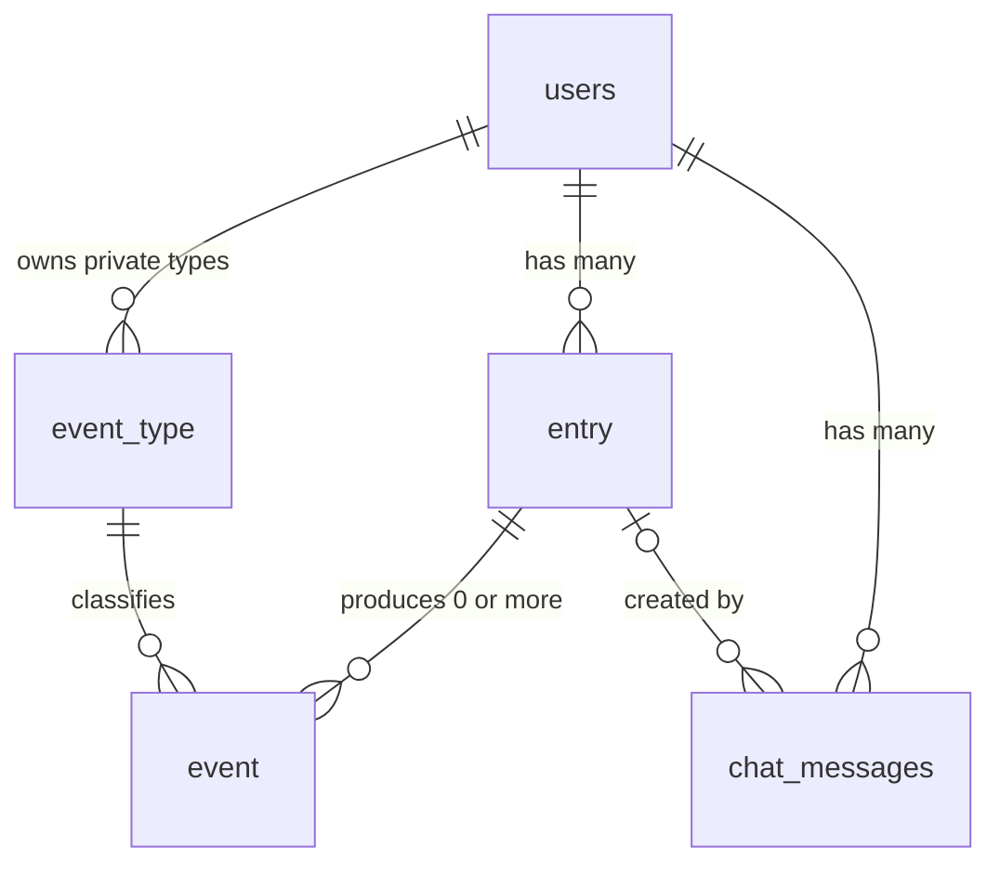

# AI Wellness Coach: Project Plan

Living design doc for this project. Last updated October 2026.

## Overview and goals

A wellness journal with an AI coach. You describe your day in plain words, above all how you felt, and the coach helps you notice what leaves you feeling good. Everything you say is kept as an entry, the AI pulls loose events out of it, and five tables hold it all, including the chat history.

The app is built for me first and shared with my wife and a few close friends. It is not marketed, and accounts are by invitation only.

Chat is the only way in: there are no forms. You check in by typing or speaking a sentence, such as:

- "Yesterday I went on a 5-mile hike and felt great."
- "Did a CrossFit class tonight and felt sluggish."
- "Had a few beers and a lot of junk food last night. Feeling rough today."
- "Slept about six and a half hours, woke up groggy but in a good mood."

Goals:

1. **Daily use:** understand which habits around food, movement, rest, and stress leave each person feeling energetic and ready for fun things.
2. **Learn new skills:** full-stack TypeScript, AI agent design with tool calling, LLM evals, and low-cost hosting outside AWS.
3. **Portfolio piece:** a live, deployed app with a clean repo and design doc to walk through in interviews.

Non-goals: calorie, macro, or gram tracking; food databases such as USDA FoodData Central; third-party imports (Strava, Concept2, wearables); performance analytics such as PRs, pace, or power; streaks or targets; medical or diet advice.

## Design principles

How you feel is the outcome that matters; everything else is context for it.

1. **Feelings over metrics.** Each event can carry a 1 to 5 feel score and the person's own feel words. Numbers like miles or hours are kept only when someone mentions them, and never required.
2. **Loose structure, not no structure.** A small set of coarse event types plus free tags gives enough shape for queries without forcing every meal or workout into a form.
3. **The person's words are the source of truth.** Every entry is saved verbatim before any AI runs. Events are an interpretation that can be corrected or re-extracted later.
4. **The model parses; the code computes.** The model turns words into proposed events. Dates and statistics come from code and SQL, never from the model.
5. **Nothing is saved without the person's say-so.** Every proposed event or change appears on a confirmation card and waits for Save.
6. **Supportive, never judgmental.** The coach is curious and encouraging about food choices and rest days, and phrases findings as patterns, not conclusions.

## Tech stack and hosting

Full-stack TypeScript in one pnpm monorepo, expected to cost roughly $0 to $10 per month including LLM usage.

| Layer      | Choice                      | Hosting                         | Notes                                                                                    |
| ---------- | --------------------------- | ------------------------------- | ---------------------------------------------------------------------------------------- |
| Frontend   | React + TypeScript, Vite    | Cloudflare Pages                | Static SPA, free tier                                                                    |
| Backend    | Hono on Cloudflare Workers  | Cloudflare Workers + Hyperdrive | Node entry for local dev and tests                                                       |
| Database   | Postgres + Drizzle ORM      | Neon                            | Scale-to-zero free tier; pgvector available later                                        |
| Auth       | Auth0 (Free plan)           | Hosted by Auth0                 | SPA signs in with OIDC + PKCE; API validates JWT access tokens against the JWKS endpoint |
| AI         | Vercel AI SDK + an LLM API  | Provider-hosted                 | Small, fast model tier for parsing                                                       |
| Validation | Zod                         | Shared package                  | One schema per tool, used everywhere                                                     |
| Testing    | Vitest + parsing eval suite | GitHub Actions                  | Evals run on every PR                                                                    |

Repo layout:

- `apps/web`: React app, chat UI, confirmation cards, read-only day view, dashboards
- `apps/api`: Hono API, agent loop, tool handlers, insight queries
- `packages/shared`: Zod schemas, types, time resolution, and signal math

The shared package is the backbone: each tool schema drives the model's tool definition, API validation, and the React confirmation card, so the three can never drift apart.

Hosting and deployment (issue #5):

- **API on Cloudflare Workers** (chosen over Fly.io): no cold starts after idle (Fly auto-stop meant 2 to 5 seconds), one platform for web and API, and no containers to maintain. The cost is a different production runtime (workerd) from local dev and tests, so CI bundles the Worker on every build to catch code that cannot run there. Fly.io remains a good fit if long-lived connections or background processes are ever needed.
- **Database access through Hyperdrive**, Cloudflare's connection pooler in front of Neon. `worker.ts` opens a postgres.js client per request on the Hyperdrive connection string; the production database URL lives in Hyperdrive and in a GitHub `production` environment (limited to `main`) for migrations.
- **Limits to watch**: the Workers free plan allows 100,000 requests per day and 10 ms of CPU per request (waiting on the database or an LLM does not count). The Phase 2 agent loop may need the $5/month plan; Hyperdrive's free plan allows 100,000 queries per day.
- **Release order on merge to `main`**: CI, then database migrations, then the Worker, then the web app on Cloudflare Pages, so a new web app never calls an older API. A failed migration stops the release and leaves the live API untouched. In the other direction, migrations run before the new Worker is live, so each one must be backward compatible with the previous Worker (add columns and tables first, then remove or rename in a later release once nothing uses them).
- **Pull request previews**: same-repository PRs get a Cloudflare Pages preview that talks to the production API. The API allows origins exactly one label below `.ai-wellness-coach.pages.dev` (only our Pages project can create them), and Auth0 has a matching wildcard callback URL. Fork PRs get no preview because they cannot read secrets. Anyone who can push a branch to this repository can deploy a preview, which is acceptable for a small project.
- The web build's settings are public identifiers kept as GitHub repository variables, because the build runs in GitHub Actions.

Tooling decisions:

- **Node 24 LTS**, pinned in `.nvmrc` and each package's `engines`. pnpm is pinned through Corepack (`packageManager` in the root `package.json`).
- **Plain pnpm workspaces** with `pnpm -r` scripts. Turborepo can be added if builds get slow.
- **`packages/shared` ships as TypeScript source**, with no build step. Vite compiles it for the web app, and `tsup` bundles it into the API build.
- **TypeScript 6.0**, because typescript-eslint does not support TypeScript 7 yet. Revisit when it does.
- **Web and API talk over `VITE_API_URL` and CORS** in every environment, so local development matches production.


The browser never talks to the database or the model directly; the API checks the user, runs the tools, and is the only component holding secrets.

## Users, access, and privacy

The app supports several people, each seeing only their own data, with accounts created by hand.

Auth decision: Auth0. It is standards-based (OAuth 2.0 and OIDC), so the skills transfer to Okta, Cognito, and Entra, and the free plan covers far more users than this app needs. Setup: one Auth0 application (SPA) for the React app using `@auth0/auth0-react`, one Auth0 API with an audience for the Hono backend, and JWT validation middleware in Hono that checks issuer, audience, and signature. The token's `sub` claim identifies the user on every query and tool call.

Auth flow (issue #4):

- **Invite-only:** sign-ups are disabled in Auth0, and accounts are created in the Auth0 dashboard. Other people are invited only after the Phase 4 cost controls (rate limits, spend cap) exist.
- **SPA:** `@auth0/auth0-react` with the authorization code flow and PKCE. Rotating refresh tokens are cached in localStorage, so reloads stay signed in even where third-party cookies are blocked. The trade-off is that an XSS bug could read them; short token lifetimes, rotation, and React's escaping limit that risk.
- **API:** a small Hono middleware on `jose` (`requireAuth`) verifies the signature against the tenant's JWKS (cached), the issuer, the audience, RS256 only, and requires `exp` and `sub`. Every failure gets the same 401. Hono's built-in `jwk` middleware is not used because it refetches the JWKS on each request and skips `exp` when the claim is absent.
- **Profile:** after sign-in the web app calls `POST /me` with the browser's time zone and any first and last name from the ID token. It creates the `users` row keyed on `auth_subject` the first time and leaves the time zone alone afterwards, so travel never shifts stored day boundaries. `requireUser` loads that row for every other route and answers 403 `profile_not_found` if it is missing. Handlers take the user id only from the loaded row.
- **Names:** social logins usually supply `given_name` and `family_name`; accounts created with an email and password often do not. When the name is missing, the coach asks for it in the first chat, and people change it by telling the coach.

Keeping data separate:

- Every query and tool call filters by the `user_id` from the loaded row, never from the request body or the model.
- Tests prove user A can never read or write user B's entries, events, chat messages, or private event types.
- Postgres row-level security is deferred: the API filter and the cross-user tests are the protection for now. Revisit it before inviting others in Phase 4.

Privacy:

- Health journals are sensitive even without medical metrics. The app owner can read the database, so every invited person is told that plainly.
- Each person can export all their entries, events, and chat history, and delete their account, which cascades to everything they own.
- Secrets live in Cloudflare (Hyperdrive holds the production database URL) and in GitHub secrets, never in the repo.
- A seeded demo account with fake data, kept separate from real people's data, is used for interviews.

## Data model

Five tables in Postgres: `users`, `entry` (what someone said), `event` (what the AI pulled out of it), `event_type` (built-in and private types), and `chat_messages` (the conversation). Every row belongs to one user. Deleting a person cascades through their entries, events, private types, and messages; deleting an entry cascades to its events.



### users

| Column                 | Type              | Notes                                                                                     |
| ---------------------- | ----------------- | ----------------------------------------------------------------------------------------- |
| id                     | uuid, primary key |                                                                                           |
| auth_subject           | text, unique      | The Auth0 `sub` claim                                                                     |
| timezone               | text              | IANA name such as America/Denver; resolves "yesterday" and day boundaries for this person |
| first_name             | text, nullable    | From the ID token's `given_name` when present, otherwise the coach asks in the first chat |
| last_name              | text, nullable    | From `family_name`; optional, since the coach only needs a first name                     |
| created_at, updated_at | timestamptz       |                                                                                           |

The `units` setting is retired (the column was dropped in #21): nothing is converted, and any number someone mentions keeps the unit they used.

### entry

One row per thing a person tells the coach, saved verbatim before any AI runs.

| Column     | Type              | Notes                                         |
| ---------- | ----------------- | --------------------------------------------- |
| id         | uuid, primary key |                                               |
| user_id    | uuid, not null    | References users, cascade delete              |
| created_at | timestamptz       | When it was entered, not when things happened |
| raw_text   | text, not null    | Exactly what the person typed or said         |

Constraint: `unique (id, user_id)`, so `event` and `chat_messages` can reference an entry together with its owner.

### event

Anything to do with health and wellness, parsed out of an entry. One entry can produce zero, one, or several events.

| Column                 | Type                  | Notes                                                                                         |
| ---------------------- | --------------------- | --------------------------------------------------------------------------------------------- |
| id                     | uuid, primary key     |                                                                                               |
| user_id                | uuid, not null        | Copied from the entry so every query filters directly by person; must match the entry's owner |
| entry_id               | uuid, not null        | References `entry (id, user_id)` together with `user_id`, cascade delete                      |
| event_type_id          | uuid, not null        | References event_type, `on delete restrict`                                                   |
| occurred_on            | date, not null        | The day it happened in the person's timezone; "yesterday" resolves here                       |
| occurred_at            | timestamptz, nullable | Only when a time is known ("at 6am")                                                          |
| summary                | text, not null        | Short label such as "5-mile hike"                                                             |
| feel_score             | smallint, nullable    | 1 (awful) to 5 (great)                                                                        |
| feel_words             | text[]                | The person's own words, such as {sluggish}                                                    |
| tags                   | text[]                | Free tags such as {hike, outdoor, with_friends, alcohol}                                      |
| details                | jsonb, nullable       | Anything else mentioned, in the person's units: {"miles": 5}                                  |
| edited                 | boolean               | True once the person corrects it; skipped when re-parsing                                     |
| created_at, updated_at | timestamptz           | When the event was saved and last corrected                                                   |

Indexes: `(user_id, occurred_on)` and `(user_id, event_type_id, occurred_on)`.

Ownership is enforced in the database, not only in code: the composite foreign key `(entry_id, user_id)` references `entry (id, user_id)`, so an event can never point at another person's entry. `event_type_id` can't use the same check, because built-in types have no owner, so the API checks that the type is visible to the person before saving (see Event types).

Feelings use one 1 to 5 score per event, inferred from the person's words ("great" is a 5, "sluggish" a 2), plus the original feel words so nuance is never lost. Words like energized, stressed, or sore go in feel words rather than separate scores. The confirmation card shows the inferred score so the person can correct it in chat.

### event_type

| Column      | Type              | Notes                                                                         |
| ----------- | ----------------- | ----------------------------------------------------------------------------- |
| id          | uuid, primary key |                                                                               |
| user_id     | uuid, nullable    | Null means built-in and visible to everyone; set means private to that person |
| name        | text, not null    | Such as `meal` or `migraine`                                                  |
| description | text, not null    | Fed to the extraction prompt so new types work without code changes           |
| created_at  | timestamptz       |                                                                               |

Constraint: `unique nulls not distinct (user_id, name)`, which needs Postgres 15 or later (Neon supports it).

### chat_messages

The conversation itself, so a chat picks up where it left off on any device. Entries hold what was logged; messages hold everything that was said, including the coach's replies.

| Column     | Type              | Notes                                                                                              |
| ---------- | ----------------- | -------------------------------------------------------------------------------------------------- |
| id         | uuid, primary key |                                                                                                    |
| user_id    | uuid, not null    | References users, cascade delete                                                                   |
| entry_id   | uuid, nullable    | The entry a user message created, if any; references `entry (id, user_id)` together with `user_id` |
| role       | text, not null    | `user`, `assistant`, or `tool`                                                                     |
| content    | text, not null    | The message text                                                                                   |
| tool_calls | jsonb, nullable   | Tool calls and results, so a conversation can be replayed to the model                             |
| created_at | timestamptz       |                                                                                                    |

Index: `(user_id, created_at)`.

The composite foreign key `(entry_id, user_id)` keeps a message and its entry on the same person. Because the link is optional and cleared when the entry is deleted, it uses `on delete set null (entry_id)`: a plain `set null` would also clear `user_id`, which can't be empty, and the delete would fail. Setting only one column needs Postgres 15 or later; Drizzle may not express it, in which case the migration adds this constraint with hand-written SQL.

Each turn, the agent loads the most recent messages (about the last 20) as context. Anything older reaches the coach through entries, events, and the read tools, so the context stays small and cheap. A clarifying back-and-forth ("How did you sleep?" / "Badly") stays as separate messages, while the entry records the combined meaning.

## Event types

Everyone sees the built-in types; a type a person adds is private to them. Types stay coarse, and specifics go in tags, so each type collects enough events for patterns to show.

### Built-in types

Seeded by a migration from `BUILT_IN_EVENT_TYPES` in `packages/shared`, which also holds the descriptions fed to the extraction prompt; a schema test checks the seed matches the constant. Only the app owner adds or changes built-ins.

| Name     | Covers                                              | Example tags                                                  |
| -------- | --------------------------------------------------- | ------------------------------------------------------------- |
| meal     | Breakfast, lunch, dinner                            | home_cooked, eating_out, heavy, late, fried                   |
| snack    | Anything eaten between meals                        | sweets, salty                                                 |
| drink    | Alcohol, caffeine, notable drinks                   | alcohol, coffee, beer                                         |
| activity | Any movement: hike, run, ride, lifting, class, walk | hike, run, bike, weights, outdoor, indoor, with_friends, solo |
| sleep    | A night's sleep or a nap, dated by the wake-up day  | nap, woke_up_often                                            |
| stress   | A stressful event or period                         | work, family, travel                                          |
| feeling  | How someone feels, not tied to another event        | energy, mood, sore, sick                                      |

Candidates to promote to built-ins later, if people start adding them as private types: `symptom` or `sick`, and `social`.

### Rules for private types

- **Visibility:** a person sees `where user_id is null or user_id = <their id>`. The same rule feeds the read tools and the extraction prompt.
- **Creation:** the API always sets `user_id` to the signed-in person, so built-ins can't be created through the app.
- **No shadowing:** a private type can't reuse a built-in name, so the model never sees two `meal` types.
- **Ownership on save:** the API checks that an event's type is visible to that person before saving, because the foreign key alone does not check ownership.
- **Deleting:** blocked while events use the type; the person moves those events to another type first.
- **Promoting:** a popular private type can become a built-in by setting its `user_id` to null, after merging any duplicates other people created.

### Tag vocabulary

The extraction prompt includes a short list of preferred tags (such as `run`, not `running` or `jog`) and the person's most-used tags. Tags outside the list are allowed, so the vocabulary grows without code changes.

## AI agent design

The model parses; the code computes. The agent turns a sentence into tool calls, and every number it shows comes from the database or from shared code, never from the model.

### Tools

The agent has write tools that always wait for confirmation and a handful of read tools. Every tool runs as the signed-in person, and the model never gets raw SQL.

| Tool                    | Kind              | What it does                                                                           |
| ----------------------- | ----------------- | -------------------------------------------------------------------------------------- |
| `list_event_types`      | Read              | Built-in types plus the person's private types, with descriptions                      |
| `propose_events`        | Write (confirmed) | Drafts the events for the current entry; nothing is saved until the person confirms    |
| `propose_event_changes` | Write (confirmed) | Corrects or deletes saved events when the person asks in chat; sets the `edited` flag  |
| `propose_event_type`    | Write (confirmed) | Suggests a new private type when nothing fits, such as `migraine`                      |
| `get_events`            | Read              | Events and their entries for a date or date range                                      |
| `search_entries`        | Read              | Finds past entries by meaning ("times I felt fried after work"); pgvector, added later |
| `find_good_days`        | Read              | Compares the person's best and worst days and what they had in common                  |
| `analyze_relationship`  | Read              | Compares two daily signals with an optional lag (see Insights)                         |

### Logging flow

A sentence becomes an entry right away, and its events are saved once the person confirms them.

1. The person types or speaks a sentence in the chat (browser speech recognition for voice).
2. The API saves it as an `entry` immediately, so the words are never lost.
3. The agent reads the visible event types and proposes zero or more events.
4. The API validates the proposal with the shared Zod schema and resolves dates in code.
5. The chat shows a confirmation card with Save and Discard. Nothing is written to `event` until Save. To change something, the person just says so in chat.
6. An entry with no events ("Work was brutal today") stays in the journal, and the coach can still read it.

Time resolution:

- "Yesterday", "this morning", and "last night" resolve in code against the person's timezone, which is passed in the agent's context.
- `occurred_on` is always set; `occurred_at` only when a time is stated or clearly implied.
- Sleep is dated by the wake-up day, so "slept badly last night" lands on the same date as this morning's workout.

Worked examples:

| Entry                                                     | Events proposed                                                                                                                     |
| --------------------------------------------------------- | ----------------------------------------------------------------------------------------------------------------------------------- |
| "Yesterday I went on a 5-mile hike and felt great."       | activity, yesterday, "5-mile hike", feel 5 {great}, tags {hike, outdoor}, details {"miles": 5}                                      |
| "Slept terribly and had a terrible workout this morning." | sleep, today, "slept badly", feel 1 {terribly}; activity, today, "morning workout", feel 1 {terrible}                               |
| "Rode with Sam then grabbed burritos, felt awesome."      | activity, "ride with Sam", feel 5, tags {bike, with_friends}; meal, "burritos", feel 5, tags {eating_out}                           |
| "Lots of beer and junk food last night, feeling rough."   | drink, yesterday, "lots of beer", tags {alcohol}; meal, yesterday, "junk food", tags {heavy, late}; feeling, today, "rough", feel 2 |
| "Work was brutal today."                                  | stress, today, "brutal work day", feel 2, tags {work}                                                                               |

After a low-feeling entry, the agent may ask one light follow-up ("How did you sleep?"). The answer is added to the same entry, and the agent never nags.

Corrections and re-parsing:

- Corrections happen in chat ("that hike was 4 miles, not 5"). The agent proposes the change with `propose_event_changes`, and saving it sets `edited = true`.
- To re-parse an entry, delete its unedited events and run extraction again. The same works across a person's whole history after a prompt improvement.
- Re-extraction shows the model the entry's edited events as already recorded and tells it not to propose them again, so a correction is never duplicated.
- Deleting an entry deletes its events.

### Guardrails

- Every tool runs as the signed-in user; authorization lives in code, never in the prompt, and the model gets no raw SQL.
- Writes always need user confirmation, which also limits prompt-injection risk from stored entries.
- The system prompt frames the agent as a supportive wellness companion: curious, encouraging, and never judgmental about food choices or rest days, with no medical or diet prescriptions.

## Insights and correlations

How you feel is the outcome; sleep, food, movement, and stress are the inputs. Questions are answered by turning events into per-day signals and comparing them in SQL, computed on the fly. With a handful of users, each with a few thousand events, no rollup table is needed.

Daily signals are one value per person per day, built from events:

- **Feel of a type:** average `feel_score` of that day's events of one type, such as activity feel or sleep feel.
- **Presence of a tag:** whether any event that day has a tag, such as `alcohol` or `late`.
- **Overall feel:** average feel score across all of that day's events.

`analyze_relationship(signal_a, signal_b, lag_days, date_range)` compares two signals. It uses Postgres `corr()` for numbers, and an average-difference comparison when one signal is yes or no.

```sql
-- Does a bad night's sleep make that day's activity feel worse?
-- Build one value per day for each signal first, so the sample size counts days, not events.
with sleep as (
  select occurred_on, avg(feel_score) as feel
  from event
  where user_id = $1 and event_type_id = $sleep and feel_score is not null
  group by occurred_on
),
activity as (
  select occurred_on, avg(feel_score) as feel
  from event
  where user_id = $1 and event_type_id = $activity and feel_score is not null
  group by occurred_on
)
select round(s.feel) as sleep_feel, avg(a.feel) as activity_feel, count(*) as days
from sleep s
join activity a on a.occurred_on = s.occurred_on + $lag_days
group by round(s.feel)
order by sleep_feel;
```

`days` is the sample size the agent reports. Events without a feel score are left out of feel signals rather than counted as neutral.

- **Lag matters:** last night's sleep and yesterday's drinks probably shape how today feels more than anything from today. A one-day lag compares day N's signal with day N+1's.
- **Good-day patterns:** `find_good_days` compares the best-feeling days with the worst on each input (sleep, activity tags, drinks, meal timing, stress). This is easier to read than a coefficient and is the main insight surface.
- **Coaching over the timeline:** for conversations, the coach also gets recent entries and events as a plain journal. It can notice patterns too nuanced for a query, and SQL checks whether they hold up over months.
- **Honest results:** tools return the sample size and date range with every result. The agent flags patterns with fewer than about 20 days of data and names likely confounders, such as a stressful week.
- **Correlation is not causation:** findings are phrased as patterns worth noticing, never as causes.

Questions this should answer:

- "What do my best-feeling days have in common?"
- "Do I feel sluggish in classes after short nights?"
- "How do I feel the day after drinking?"
- "Do outdoor rides with friends lift my mood more than solo workouts?"
- "I've felt flat all week. What's different from a good week?"

Dashboards: a calendar of how each day felt, a feel trend over time, the activity mix by tag (outdoor, social, indoor), and sleep feel over time.

## Quality, cost, and security

A parsing eval suite in CI is the feature that sets this project apart: it proves the extraction works and catches regressions when prompts or models change.

### Eval suite

- 50 to 100 example sentences, each paired with the expected events, stored as JSON in the repo.
- Scored on event type, date, feel score (within 1), and key tags, not on the exact wording of the summary. Fail the build below a set accuracy.
- Cover the hard cases: feel words to scores ("meh", "wiped out but happy"), several events in one sentence, relative times ("last night", "yesterday"), sleep dating, entries that should produce no events, and re-parsing an entry that has edited events without duplicating them.
- Run on every PR in GitHub Actions; track accuracy over time in the README.

### Testing

- Vitest unit tests for shared logic: time resolution and signal math.
- API tests for each tool handler, including authorization (user A can never read user B's data) and private type visibility.
- Database tests apply the committed drizzle-kit migrations to an in-memory Postgres (PGlite), so they run the same SQL as Neon without Docker, a network, or secrets. CI also fails if `schema.ts` changes without a committed migration.

### CI and code review

- GitHub Actions runs lint, format check, typecheck, tests, and build on every pull request and push to `main`. Branch protection requires a pull request and a passing `CI` check, with no admin bypass.
- Claude reviews each pull request when it is opened or marked ready, against `CLAUDE.md` and the linked issue's definition of done, and posts inline and summary comments. Commenting `@claude review` asks for a re-review. The review is advisory: it never approves or blocks a merge.
- The Claude workflows have read-only access to code and authenticate with a `CLAUDE_CODE_OAUTH_TOKEN` repository secret. Only users with write access can trigger them, so fork pull requests cannot use the token.

### Cost controls

Other people's chats spend the app owner's LLM budget, so these are required before inviting anyone:

- A hard monthly spend limit in the LLM provider's console.
- Per-user rate limits on chat and extraction, and chat only after sign-in.
- A small, fast model for parsing; a larger one only if coaching needs it.

## Decisions

Recorded while simplifying the design in October 2026.

| Decision           | Outcome                                                                                       |
| ------------------ | --------------------------------------------------------------------------------------------- |
| Data model         | Five tables (`users`, `entry`, `event`, `event_type`, `chat_messages`) replace eleven planned |
| Nutrition          | No USDA data, quantities, or macros; meals and snacks are ordinary events with tags           |
| Input              | Chat only; no manual forms; corrections happen in chat                                        |
| Feel score         | One 1 to 5 score per event, with feel words for nuance                                        |
| Confirmation       | Always confirm; every proposed event or change waits for Save                                 |
| Built-in types     | meal, snack, drink, activity, sleep, stress, feeling                                          |
| Chat history       | Kept in `chat_messages` so conversations continue across sessions                             |
| Units              | Dropped; details keep whatever unit the person said                                           |
| Row-level security | Deferred; API filter plus cross-user tests for now, revisit before inviting others            |
| Insights           | Daily signals computed on the fly; no `daily_summary` table                                   |
| Ownership          | Composite foreign keys keep each event and chat message on the same person as its entry       |

## Roadmap

Five phases, each deployed and usable on its own, so there is always something to show in an interview. Each phase is a GitHub milestone; the work items are tracked as issues.

### Phase 1: Foundation

- Done: pnpm monorepo, Auth0 sign-in, Neon with Drizzle migrations, Workers and Pages deploys, CI, Claude PR review
- Update this design doc and `CLAUDE.md` for the simplified design
- Add the `entry`, `event`, `event_type`, and `chat_messages` tables and seed the built-in types
- Done: dropped the replaced tables (`activities`, `activity_details`, `checkins`, `rest_logs`) and `users.units`
- Store first and last name from the ID token

### Phase 2: Natural-language logging

- Chat UI with streaming responses, saved to `chat_messages` so conversations carry over between sessions
- Save each entry, then `propose_events` with a confirmation card
- Time resolution in `packages/shared` with unit tests
- Read-only day view of entries and events
- The coach asks for a missing name
- First 30 eval cases running in CI

### Phase 3: Custom types, corrections, and voice

- `propose_event_type` and private types with the visibility rules
- `propose_event_changes`, the `edited` flag, and re-parsing
- Voice input with browser speech recognition
- Grow the eval suite to 75+ cases

### Phase 4: Insights and sharing

- Daily signals, `analyze_relationship`, and `find_good_days`, with sample size and caveats
- Dashboards: feeling calendar, feel trend, activity mix, sleep
- Per-user rate limits, a spend cap, export, and delete; revisit row-level security; then invite family and friends

### Phase 5: Coach and polish

- Coaching conversations over the full history ("What helps me feel my best?")
- pgvector search over entries
- Seeded demo account with fake data
- README with architecture, eval results, and a short demo video
